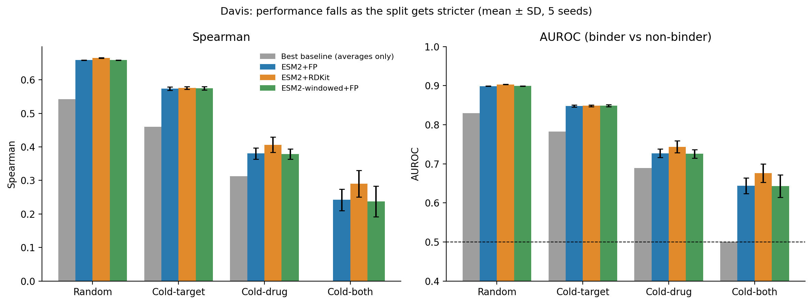

# Do Drug-Target Affinity Models Generalize? A Cold-Split Benchmark on Davis

## Research question
How much of a drug-target affinity (DTA) model's score on the Davis kinase dataset comes from memorizing drug and kinase identities, and how much survives when the drug, the kinase, or both are unseen at test time?

## Summary of findings
- **Random splits partly measure memorization.** A baseline that uses only per-drug and per-kinase averages (no chemistry, no sequence) reaches Spearman 0.542 on a random split.
- **A real model beats every baseline in every setting, but the score drops sharply as the split gets stricter.** ESM-2 + Morgan fingerprint LightGBM falls from Spearman 0.659 (random) to 0.242 (cold-both).
- **Richer drug features helped only when the drug was unseen.** Replacing the fingerprint with count fingerprints + MACCS + RDKit descriptors gave +0.027 Spearman (cold-drug) and +0.048 (cold-both), but only +0.006 (random) and +0.002 (cold-target). The gain is about 1 to 1.5 SD, so it is a consistent trend, not a significance test.
- **Windowed ESM-2 embeddings made no difference.** Re-embedding the 70 kinases longer than 1022 residues changed Spearman by less than 0.005.

## Data
- Davis et al. (2011) kinase inhibitor dataset, taken from the DeepDTA repository.
- 68 drugs x 442 kinase entries = 30,056 measured pairs.
- Affinity: pKd = -log10(Kd / 1e9), with Kd in nM. Range 5.0 to 10.8.
- **69.6% of pairs sit at the pKd 5.0 floor**, meaning no measurable binding. This is a censored value, not an exact measurement.
- 442 kinase entries share only 379 unique sequences, because many entries are mutants or phosphorylation states of the same protein.

## Methods
| Step | Description |
|---|---|
| Kinase groups | Entries merged if they share a base gene name or an identical sequence (442 entries -> 379 groups) |
| Split: random | Rows assigned to 5 folds at random |
| Split: cold-drug | Whole drugs held out |
| Split: cold-target | Whole kinase groups held out |
| Split: cold-both | Test drug and test kinase are both unseen. Training excludes both |
| Leakage check | Code asserts zero shared drugs, groups or sequences in the cold settings |
| Baselines | Global mean, drug mean, target mean, drug+target additive (unseen entries fall back to the global mean) |
| Protein features | Mean-pooled ESM-2 35M embedding (480-d), facebook/esm2_t12_35M_UR50D |
| Drug features | **FP:** 1024-bit Morgan (radius 2). **RDKit:** Morgan counts + MACCS keys + 184 RDKit descriptors |
| Model | LightGBM, 300 trees, learning rate 0.05, 31 leaves, no tuning |
| Variants | ESM2+FP, ESM2+RDKit, ESM2-windowed+FP (windows of 1000 residues, stride 500, for sequences over 1022) |
| Evaluation | 5-fold cross-validation x 5 seeds. Mean over folds, then mean and SD over seeds |
| Metrics | Spearman, AUROC (binder = pKd > 5), RMSE |

## Results
Mean over 5 seeds. The baseline column shows the best baseline in each setting.

### Spearman
| Setting | Best baseline | ESM2+FP | ESM2+RDKit | ESM2-windowed+FP |
|---|---|---|---|---|
| random | 0.542 | 0.659 ± 0.001 | **0.665 ± 0.001** | 0.659 ± 0.000 |
| cold-target | 0.460 | 0.574 ± 0.005 | 0.576 ± 0.004 | 0.575 ± 0.005 |
| cold-drug | 0.313 | 0.380 ± 0.016 | **0.407 ± 0.023** | 0.379 ± 0.015 |
| cold-both | 0.000 | 0.242 ± 0.032 | **0.290 ± 0.040** | 0.237 ± 0.046 |

### AUROC (binder vs non-binder)
| Setting | Best baseline | ESM2+FP | ESM2+RDKit | ESM2-windowed+FP |
|---|---|---|---|---|
| random | 0.829 | 0.899 | 0.903 | 0.899 |
| cold-target | 0.782 | 0.848 | 0.849 | 0.849 |
| cold-drug | 0.689 | 0.727 | 0.744 | 0.726 |
| cold-both | 0.500 | 0.644 | 0.676 | 0.643 |

### RMSE
| Setting | Best baseline | ESM2+FP | ESM2+RDKit | ESM2-windowed+FP |
|---|---|---|---|---|
| random | 0.734 | 0.559 | 0.552 | 0.559 |
| cold-target | 0.793 | 0.696 | 0.694 | 0.700 |
| cold-drug | 0.846 | 0.796 | 0.790 | 0.797 |
| cold-both | 0.904 | 0.873 | 0.864 | 0.876 |

The cold-both baseline scores Spearman 0 and AUROC 0.5 by construction: with both drug and kinase unseen, every baseline falls back to a constant prediction.



## Error analysis
Cold-both, seed 0, ESM2+RDKit.
- Median per-drug Spearman 0.21 (range -0.36 to 0.58). For the worst drug the model ranks kinases backwards.
- Median per-kinase-group Spearman 0.19 (n = 357 groups, about 14 drugs each, so single-group values are noisy).
- Largest mean absolute errors: DDR1, FLT3, RET, EPHB6, ABL2, KIT, TAK1, PDGFRB, mostly receptor tyrosine kinases. A possible explanation is that these kinases have many truly strong binders against a label distribution dominated by the floor value. This was not tested.

## Limitations
- Only 68 drugs. Cold-drug test folds hold about 14 drugs, so estimates are noisy.
- The 5 seeds re-partition the same 68 drugs and 379 kinase groups, so they are not independent samples. No formal significance test or paired fold comparison was run.
- Kinase grouping uses identical sequences and gene names only. Related but different kinases (for example ABL1 and ABL2) can fall on opposite sides of a split.
- 69.6% of labels are a censored floor value, but regression metrics treat them as exact.
- 70 of 379 sequences exceed 1022 residues and were truncated. Windowing did not change results.
- One protein model size (35M), one learner (LightGBM), no hyperparameter tuning.
- Mean-pooled embeddings and fingerprints only. No structure, no learned drug encoder.
- Error analysis uses one seed and one variant.
- Not compared with published DTA models. These results say nothing about them.

## Future work
- Paired per-fold comparison of RDKit vs fingerprint features.
- Larger ESM-2 sizes and attention pooling over residues.
- Group kinases by sequence similarity instead of exact identity.
- Evaluate on a larger dataset with more drugs (for example KIBA).

## Reproduce
Everything runs on the free Colab CPU tier. Open `notebooks/dta_coldsplit_benchmark.ipynb` and run the cells top to bottom. Slow steps save to Google Drive, and the 5-seed run resumes after an interruption. Total run time is roughly 1.5 to 2 hours, mostly the 5-seed run (about 48 minutes). Embeddings and the raw data are not stored in this repo.

## Repository structure
```
.
├── README.md
├── notebooks/   # Colab notebook
└── results/     # 5-seed results, baselines, seed-0 variants, cold-both predictions
```

## References
- Davis, M. I. et al. Comprehensive analysis of kinase inhibitor selectivity. Nature Biotechnology 29, 1046-1051 (2011).
- Öztürk, H., Özgür, A., Ozkirimli, E. DeepDTA: deep drug-target binding affinity prediction. Bioinformatics 34, i821-i829 (2018).
- Lin, Z. et al. Evolutionary-scale prediction of atomic-level protein structure with a language model. Science 379, 1123-1130 (2023).

## Author
GitHub: tehreemraouf-06
